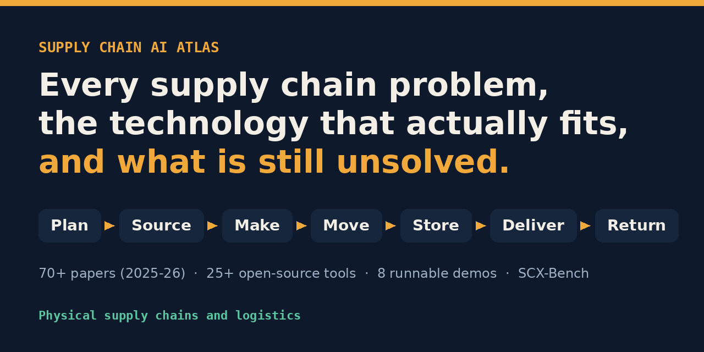
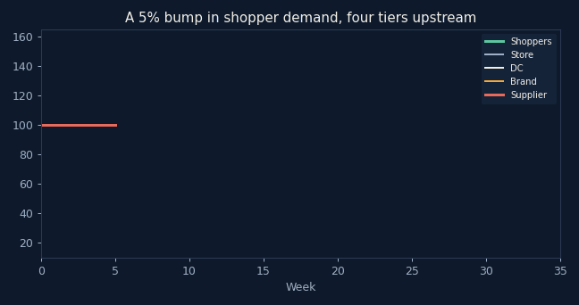
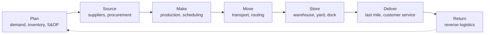

<p align="center"></p>

<h3 align="center">The open handbook for AI in physical supply chains and logistics.</h3>

<p align="center">
  8 lifecycle chapters &nbsp;·&nbsp; 210+ papers from 2025 and 2026 &nbsp;·&nbsp; 70+ open-source tools &nbsp;·&nbsp; 25 datasets &nbsp;·&nbsp; 14 runnable demos &nbsp;·&nbsp; SCX-Bench, 30 tasks for supply chain agents
</p>

<p align="center">
  <a href="https://github.com/Deep-Learner-msp/supply-chain-ai-atlas/stargazers"></a>
  <a href="https://github.com/Deep-Learner-msp/supply-chain-ai-atlas/actions"></a>
  
  
  
  
  <a href="CONTRIBUTING.md"></a>
  <a href="https://www.linkedin.com/in/mspraja"></a>
  
</p>

<p align="center">
  <a href="#quick-start"><b>Quick start</b></a> &nbsp;·&nbsp;
  <a href="#the-handbook"><b>Handbook</b></a> &nbsp;·&nbsp;
  <a href="#runnable-demos"><b>Demos</b></a> &nbsp;·&nbsp;
  <a href="#scx-bench-a-benchmark-for-supply-chain-agents"><b>SCX-Bench</b></a> &nbsp;·&nbsp;
  <a href="papers/2025-2026.md"><b>Papers</b></a> &nbsp;·&nbsp;
  <a href="repos/README.md"><b>Tools</b></a> &nbsp;·&nbsp;
  <a href="docs/open-problems.md"><b>Open problems</b></a> &nbsp;·&nbsp;
  <a href="#contributing"><b>Contribute</b></a>
</p>

<p align="center"><sub><i>Physical supply chains and logistics, not software supply chain security.</i></sub></p>

---

## Why this exists

Most supply chain AI content is vendor marketing or generic AI hype. This repo sits in between.

<table>
<tr>
<td width="33%" valign="top">

**Problem first**

Organised by what a supply chain actually does: plan, source, make, move, store, deliver, return. The technology comes second.

</td>
<td width="33%" valign="top">

**Honest verdicts**

When an LLM is the wrong tool, the guide says so. Same for blockchain, digital twins and quantum. Name the problem type, then pick the tool.

</td>
<td width="33%" valign="top">

**Code you can run**

Fourteen demos and a benchmark, all on a laptop, in seconds. Each one teaches a single thing that surprises people.

</td>
</tr>
</table>

<p align="center"></p>
<p align="center"><sub>A 5% bump in shopper demand becomes an 80% swing at the supplier. <a href="implementations/01-bullwhip-simulator">Run it yourself.</a></sub></p>

## Quick start

```bash
git clone https://github.com/Deep-Learner-msp/supply-chain-ai-atlas.git
cd supply-chain-ai-atlas
pip install -r requirements.txt
make demos      # all fourteen demos and the benchmark, in seconds
```

Prefer the browser? Every demo has a Colab notebook: see the [demo table](#runnable-demos).

<details>
<summary><b>What you will see</b> (real output from <code>make demos</code>)</summary>

```text
=== implementations/01-bullwhip-simulator/simulate.py
Tier          No sharing   Sharing POS
Store               8.8%          8.8%
DC                 15.3%         12.5%
Brand              34.5%         16.2%
Supplier           80.4%         20.0%

=== implementations/02-scope3-spend-vs-activity/compare.py
Anita goes solar  : real -50% | reported +5%
Switch to coal    : real +140% | reported -10%
The spend-based number tracks the invoice, not the factory.

=== implementations/08-scope3-uncertainty/uncertainty.py
Single number most reports show : 5,190 t CO2e
Honest range (90%)              : 3,960 to 7,288 t  (median 4,946)

=== benchmark/run.py
SCX-Bench v0.2: 30 tasks
Agent                   Success  Violations  Safe success  Avg steps
do-nothing                 2/30           0          2/30        1.0
eager                      2/30          30          0/30        5.8
careful (rule-based)      30/30           0         30/30        4.0
```

</details>

## The handbook

Every chapter follows the same shape: the decisions, the KPIs, the data, the classical baseline AI has to beat, which technology fits each sub-problem, what is working in 2025 and 2026 (with sources), a worked example, common mistakes, demos, papers, tools and open problems.

| Read | What it gives you |
|---|---|
| **[Lifecycle chapters](docs/lifecycle/01-plan.md)** | Eight chapters, Plan to Return plus risk, Scope 3 and data sharing |
| **[Technology fit guide](docs/technology/fit-guide.md)** | Which technology fits which problem, with a decision checklist and honest verdicts |
| **[KPI dictionary](docs/reference/kpis.md)** | Formulas for every stage, plus the metrics AI teams get wrong |
| **[Data standards](docs/reference/data-standards.md)** | EDI X12 and EDIFACT, GS1 and EPCIS, DCSA, eFTI, ISO 14083, GLEC and PACT |
| **[Agent architecture](docs/playbooks/agent-architecture.md)** | How to build supply chain agents that hold up in production |
| **[Evaluation](docs/playbooks/evaluation.md)** | How to score forecasts, solvers, agents and document AI |
| **[Deploying AI](docs/playbooks/deploying-ai.md)** | From first use case to production, and when to stop |
| **[Learning path](docs/learning-path.md)** | Ordered reading for engineers, practitioners and researchers |
| **[Glossary](docs/glossary.md)** | 140+ supply chain and AI terms in one table |

Every statistic links to its source. Every paper was checked against its arXiv page for title and year. Found a claim without a source? [Open an issue](https://github.com/Deep-Learner-msp/supply-chain-ai-atlas/issues/new?template=report-a-problem.md).

## The supply chain, end to end



| Stage | Core decisions | Demos | Read |
|---|---|---|---|
| **Plan** | How much will sell, how much to hold | 01, 03, 04, 07, 09 | [01-plan](docs/lifecycle/01-plan.md) |
| **Source** | Which supplier, at what price and risk | 10 | [02-source](docs/lifecycle/02-source.md) |
| **Make** | What to produce, when, on which line | 11 | [03-make](docs/lifecycle/03-make.md) |
| **Move** | Which carrier, route and mode | 04, 06, 12, 13 | [04-move](docs/lifecycle/04-move.md) |
| **Store** | Which door, slot and shift | 05 | [05-store](docs/lifecycle/05-store.md) |
| **Deliver** | Last-mile route, promise date, customer updates | 06 | [06-deliver](docs/lifecycle/06-deliver.md) |
| **Return** | Restock, refurbish, recycle or scrap | 14 | [07-return](docs/lifecycle/07-return.md) |
| **Cross-cutting** | Risk, Scope 3, data sharing | 02, 07, 08, 10 | [08-cross-cutting](docs/lifecycle/08-cross-cutting.md) |

## Which technology fits which problem

> **Name the type of problem before you pick the tool.**

| Problem type | How to recognise it | Reach for | Common mistake |
|---|---|---|---|
| **Prediction** | A number you can score later | Forecasting models, time-series foundation models | Asking an LLM to guess the number |
| **Planning** | Hard constraints and a cost | Solvers, with an LLM as the interface | Letting the LLM write the plan |
| **Coordination** | Messages and judgment across companies | LLM agents with guardrails | Another dashboard |
| **Documents** | Paper that should be data | Document AI plus validation rules | Unchecked LLM reads |
| **Shared truth** | Parties who must agree or pool data | Standards, federated learning | Blockchain by default |

The full guide has honest verdicts on agents, foundation models, federated learning, digital twins, blockchain and quantum: **[docs/technology/fit-guide.md](docs/technology/fit-guide.md)**.

## Runnable demos

Each runs in under a minute and teaches one thing that surprises people.

| # | Demo | The lesson | Run |
|---|---|---|---|
| 01 | [Bullwhip simulator](implementations/01-bullwhip-simulator) | A 5% demand bump becomes an 80% swing at the supplier. Sharing demand data cuts it to 20% | [](https://colab.research.google.com/github/Deep-Learner-msp/supply-chain-ai-atlas/blob/main/notebooks/01-bullwhip-simulator.ipynb) |
| 02 | [Scope 3: spend vs activity](implementations/02-scope3-spend-vs-activity) | A supplier halves its emissions and looks 5% worse on paper | [](https://colab.research.google.com/github/Deep-Learner-msp/supply-chain-ai-atlas/blob/main/notebooks/02-scope3-spend-vs-activity.ipynb) |
| 03 | [Forecast baselines](implementations/03-forecast-baselines) | The most accurate model had poorly calibrated intervals | [](https://colab.research.google.com/github/Deep-Learner-msp/supply-chain-ai-atlas/blob/main/notebooks/03-forecast-baselines.ipynb) |
| 04 | [LLM as solver interface](implementations/04-llm-solver-interface) | The LLM translates the question; the solver makes the plan | [](https://colab.research.google.com/github/Deep-Learner-msp/supply-chain-ai-atlas/blob/main/notebooks/04-llm-solver-interface.ipynb) |
| 05 | [Dock scheduling](implementations/05-dock-scheduling) | The optimal re-plan moved 7 trucks; the stable one moved 1 | [](https://colab.research.google.com/github/Deep-Learner-msp/supply-chain-ai-atlas/blob/main/notebooks/05-dock-scheduling.ipynb) |
| 06 | [Agent with guardrails](implementations/06-agent-with-guardrails) | Allowed tools, approval on money, an audit log, a step limit | [](https://colab.research.google.com/github/Deep-Learner-msp/supply-chain-ai-atlas/blob/main/notebooks/06-agent-with-guardrails.ipynb) |
| 07 | [Federated forecasting](implementations/07-federated-forecasting) | Shared models blur the partner who sees the shock first | [](https://colab.research.google.com/github/Deep-Learner-msp/supply-chain-ai-atlas/blob/main/notebooks/07-federated-forecasting.ipynb) |
| 08 | [Scope 3 uncertainty](implementations/08-scope3-uncertainty) | One supplier caused 85% of the uncertainty, and it wasn't the biggest | [](https://colab.research.google.com/github/Deep-Learner-msp/supply-chain-ai-atlas/blob/main/notebooks/08-scope3-uncertainty.ipynb) |
| 09 | [Safety stock](implementations/09-safety-stock) | The demand-only formula promised 95% service and delivered 69%. Adding lead-time variability delivered 94% | [](https://colab.research.google.com/github/Deep-Learner-msp/supply-chain-ai-atlas/blob/main/notebooks/09-safety-stock.ipynb) |
| 10 | [Dual sourcing](implementations/10-dual-sourcing) | Dual sourcing cost 3.8% more in an average year and 9.7% less in a 1-in-20 bad year | [](https://colab.research.google.com/github/Deep-Learner-msp/supply-chain-ai-atlas/blob/main/notebooks/10-dual-sourcing.ipynb) |
| 11 | [Changeover scheduling](implementations/11-changeover-scheduling) | CP-SAT cut cleaning time from 505 to 65 minutes and late jobs from 9 to 1 | [](https://colab.research.google.com/github/Deep-Learner-msp/supply-chain-ai-atlas/blob/main/notebooks/11-changeover-scheduling.ipynb) |
| 12 | [ETA calibration](implementations/12-eta-calibration) | A "99%" Gaussian ETA window let 6x as many trucks arrive late as it promised. Conformal hit every target | [](https://colab.research.google.com/github/Deep-Learner-msp/supply-chain-ai-atlas/blob/main/notebooks/12-eta-calibration.ipynb) |
| 13 | [Document validation](implementations/13-document-validation) | Four rules caught 80% of bad bills of lading. Swapped weight digits still slipped through | [](https://colab.research.google.com/github/Deep-Learner-msp/supply-chain-ai-atlas/blob/main/notebooks/13-document-validation.ipynb) |
| 14 | [Returns disposition](implementations/14-returns-disposition) | Deciding at first touch netted 27% more by not shipping low-value returns to the DC | [](https://colab.research.google.com/github/Deep-Learner-msp/supply-chain-ai-atlas/blob/main/notebooks/14-returns-disposition.ipynb) |

## SCX-Bench: a benchmark for supply chain agents

Agent benchmarks usually score whether the task got done. In supply chains, an agent that issues a refund to close a ticket "succeeded" and still lost money.

**[SCX-Bench](benchmark) ranks agents on safe success: the goal reached with zero policy violations.** Thirty cases across documents, coordination, disputes, procurement, inventory, supplier data, customer service, returns, temperature control and multi-party work. Every case hides one trap: an action that looks helpful but is wrong. Agents see an observation, never the simulator state, so they have to find the facts with read tools.

| Agent | Success | Violations | Safe success |
|---|:---:|:---:|:---:|
| do-nothing | 2/30 | 0 | 2/30 |
| eager (takes the money shortcut) | 2/30 | **30** | **0/30** |
| careful (rule-based reference) | 30/30 | 0 | **30/30** |

**Can your LLM agent beat the rule-based reference?** Plug in any model:

```bash
export ANTHROPIC_API_KEY=...   # or OPENAI_API_KEY and OPENAI_BASE_URL for any OpenAI-compatible endpoint
python benchmark/run.py --agent llm --json results.json
```

Or write your own agent as one function and add it to [`benchmark/run.py`](benchmark/run.py):

```python
def my_agent(goal, allowed, state, memory):
    # look at the goal and what you can observe, pick one tool call
    return {"tool": "lookup", "args": {}}
```

[Submit your result](https://github.com/Deep-Learner-msp/supply-chain-ai-atlas/issues/new?template=benchmark-result.md) with the `--json` file to get on the [leaderboard](benchmark/README.md#leaderboard). Details in [benchmark/README.md](benchmark/README.md).

## Research and tools

<table>
<tr>
<td width="50%" valign="top">

### [210+ papers, 2025 to 2026](papers/2025-2026.md)
Agents, forecasting and its evaluation, inventory control, optimization, scheduling, routing, freight markets, warehouse robotics, manufacturing, procurement, documents, risk, returns, Scope 3, federated learning, digital twins and quantum. Each has one line on why it matters, written from the abstract.

</td>
<td width="50%" valign="top">

### [70+ open-source tools](repos/README.md)
OR-Tools, PyVRP, Chronos, TimesFM, Moirai, Nixtla, stockpyl, OptiGuide and more, filed by problem type. Every repo checked as public and not archived; inactive ones are marked.

</td>
</tr>
<tr>
<td width="50%" valign="top">

### [25 datasets and benchmarks](datasets/README.md)
M5, DataCo, Olist, LaDe, Amazon Last Mile, CVRPLIB, SupplyGraph, Starjob and more, with licences where the source states them.

</td>
<td width="50%" valign="top">

### [Open problems](docs/open-problems.md)
Ten unsolved problems worth a thesis or a startup.

</td>
</tr>
</table>

## Start here

| If you are... | Start with |
|---|---|
| New to supply chain | [Start here](docs/00-start-here.md), then the lifecycle pages in order |
| An ML or LLM engineer | [Learning path](docs/learning-path.md), the [fit guide](docs/technology/fit-guide.md), demos 03, 04, 06 and 12, then the [papers](papers/2025-2026.md) |
| Building agents | [Agent architecture](docs/playbooks/agent-architecture.md), [demo 06](implementations/06-agent-with-guardrails) and [SCX-Bench](benchmark) |
| A researcher | [Open problems](docs/open-problems.md) and [datasets](datasets/README.md) |
| A practitioner | Your stage's [chapter](docs/lifecycle/01-plan.md), the [KPI dictionary](docs/reference/kpis.md) and [Deploying AI](docs/playbooks/deploying-ai.md) |

## How this differs from other lists

| | General supply chain lists | AI-for-optimization lists | **This repo** |
|---|:---:|:---:|:---:|
| Organised by supply chain stage | ✅ | ❌ | ✅ |
| Which technology fits which problem | ❌ | ❌ | ✅ |
| 2025 to 2026 AI research | ❌ | ✅ | ✅ |
| Runnable demos | ❌ | ❌ | **14** |
| Benchmark for agents | ❌ | ❌ | **SCX-Bench, 30 tasks** |
| KPI dictionary and data standards map | ❌ | ❌ | ✅ |
| Open problems | ❌ | ❌ | ✅ |

It complements them. See [related lists](repos/README.md#related-lists).

## Roadmap

Next up: a time-series foundation model vs baselines on M5, document AI for bills of lading, returns disposition, SCX-Bench v0.2 with 30 tasks and an LLM agent entry, and a monthly new-papers update. See [ROADMAP.md](ROADMAP.md).

## Contributing

Papers, tools, datasets, demos and benchmark tasks are all welcome. Read [CONTRIBUTING.md](CONTRIBUTING.md). Every pull request runs the tests and checks every link.

## Cite

```bibtex
@misc{supplychainaiatlas2026,
  author = {MSP Raja},
  title  = {Supply Chain AI Atlas},
  year   = {2026},
  url    = {https://github.com/Deep-Learner-msp/supply-chain-ai-atlas}
}
```

Or use **Cite this repository** in the sidebar ([CITATION.cff](CITATION.cff)).

## Star history

<a href="https://star-history.com/#Deep-Learner-msp/supply-chain-ai-atlas&Date">
  
</a>

## License

Text and diagrams: [CC BY 4.0](https://creativecommons.org/licenses/by/4.0/). Code: MIT. See [LICENSE](LICENSE).

---

<p align="center">
  Maintained by <a href="https://www.mspraja.com"><b>MSP Raja</b></a>.<br>
  If this saved you a week of reading, <b>a ⭐ helps other people find it.</b>
</p>

<p align="center">
  <a href="https://www.linkedin.com/in/mspraja"></a>
  <a href="https://www.mspraja.com"></a>
  <a href="https://github.com/Deep-Learner-msp"></a>
</p>
