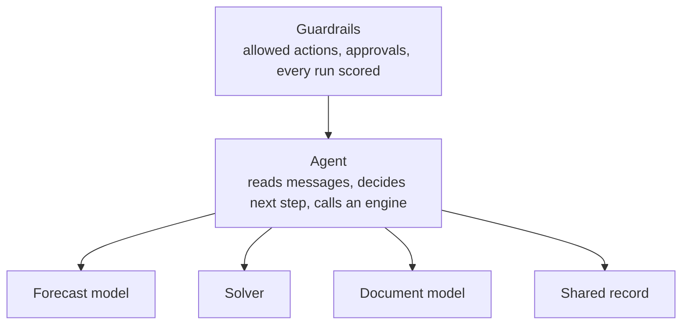

# Technology fit guide

Name the type of problem first. Then pick the tool.

| Problem type | How to recognise it | Reach for | Common mistake |
|---|---|---|---|
| Prediction | The answer is a number you can score later (ETA, demand, dwell time) | Gradient-boosted trees, time-series models, time-series foundation models (Chronos, TimesFM, Moirai) as baselines | Asking an LLM to guess the number |
| Planning | Hard constraints and a cost to minimize (loads, routes, dock slots, production runs) | MILP and routing solvers; an LLM to translate the question and explain the answer | Letting an LLM produce the plan |
| Coordination | Messages, follow-ups and judgment across companies | LLM agents with tools, a fixed list of allowed actions, human approval on money | Another dashboard that leaves the follow-up to people |
| Documents | Information on paper or PDF that should be fields in a system | Document AI or vision-language models plus hard validation rules | An LLM read with nothing checking its output |
| Shared truth | Several parties must agree on what happened, or pool data they won't share | Neutral platforms and standards first; federated learning to share models, not data; a ledger only for a narrow audit job | Starting with the ledger instead of with who has agreed to join |

## Decision checklist

Answer these in order before picking a tool. Most failed projects skip to question 6.

| # | Question | If yes | If no |
|---|---|---|---|
| 1 | Is there a decision someone makes today, and a named owner for it? | Continue | Stop. A model with no decision behind it becomes a dashboard |
| 2 | Can you measure how well it is made today? | Record the baseline, continue | Measure first. Without a baseline you cannot show a gain ([deploying AI](../playbooks/deploying-ai.md)) |
| 3 | Is the answer a number you will be able to check later? | **Prediction.** Start with simple baselines and score the error bar | Continue |
| 4 | Are there hard constraints (capacity, time windows, rules) and a cost? | **Planning.** Use a solver; an LLM may translate the question and explain the answer | Continue |
| 5 | Is the work reading, writing and chasing messages across people or companies? | **Coordination.** An agent with narrow tools, allowed-action lists and approvals ([agent architecture](../playbooks/agent-architecture.md)) | Continue |
| 6 | Is the input a document that should become fields? | **Documents.** Extraction plus validation rules; measure per field | Continue |
| 7 | Do several parties need to agree on facts or pool data? | **Shared truth.** Standards and governance first ([data standards](../reference/data-standards.md)); then federated learning or a shared record if still needed | Re-read the problem; it may be a process fix, not a technology |
| 8 | Does a wrong answer move money, make a commitment, or touch a regulator? | Human approval on that action, always | Automate inside limits |
| 9 | Is the data the method needs available, at the frequency the decision needs? | Build | Fix the data first; no model fixes a missing feed |
| 10 | Is there a rule or formula that gets most of the value? | Ship it first. "Don't be afraid to launch a product without machine learning" ([Google, Rules of ML](https://developers.google.com/machine-learning/guides/rules-of-ml)) | Use the method from step 3 to 7 |

Many real use cases are two types in a chain. Returns disposition is prediction (what grade is this item?) feeding planning (where should it go?), as in [demo 14](../../implementations/14-returns-disposition). Name both and evaluate both ([evaluation playbook](../playbooks/evaluation.md)).

## The shape that holds up in production

The agent coordinates. Engines compute. Guardrails decide what gets executed. The full design, including tool gateway, idempotency and audit log, is in the [agent architecture playbook](../playbooks/agent-architecture.md).

## Honest verdicts on the hyped technologies

| Technology | Verdict for supply chain today |
|---|---|
| LLM agents | Ready for coordination work, with limits and approvals |
| Time-series foundation models | Strong, cheap baselines; check calibration before trusting the error bars |
| LLM + optimization | Useful as an interface to solvers, not as a solver |
| Federated learning | Ready for pilots between partners; incentives are the hard part |
| Digital twins | Useful as the state agents reason over and as a test bed for agents |
| Blockchain | A narrow job: audit trails where no single operator is trusted |
| Quantum optimization | Watch, don't buy. Classical solvers win today |

The evidence behind each verdict follows.

### LLM agents: ready for coordination, with limits and approvals

| Evidence | What it shows |
|---|---|
| [τ-bench](https://arxiv.org/abs/2406.12045) (2024, background) | On simulated customer-service tasks with domain rules, strong function-calling agents solved under half the tasks and were inconsistent across repeated runs (pass^8 under 25% in retail) |
| [Reliability and Effectiveness of Autonomous AI Agents in SCM](https://arxiv.org/abs/2605.17036) (2026) | In the beer game, LLM agents cut total cost by up to 80% vs human teams in the best setup, but showed large run-to-run swings ("agent bullwhip"); guardrails on extreme decisions reduced tail events |
| [Why Do Multi-Agent LLM Systems Fail?](https://arxiv.org/abs/2503.13657) (2025) | 14 failure modes from 1,600+ annotated traces, grouped into system design, inter-agent misalignment and task verification |
| [OWASP Top 10 for LLM Applications](https://genai.owasp.org/llm-top-10/) | Prompt injection and excessive agency are listed risks; both apply to agents that read outside parties' emails and documents |
| [Gartner, June 2025](https://www.gartner.com/en/newsroom/press-releases/2025-06-25-gartner-predicts-over-40-percent-of-agentic-ai-projects-will-be-canceled-by-end-of-2027) | Predicts over 40% of agentic AI projects will be cancelled by end of 2027, citing costs, unclear value and weak risk controls |
| [SCX-Bench](../../benchmark) (this repo) | An eager agent that takes the money shortcut scores zero safe successes; a careful rule-based agent solves every task within policy |

Why the verdict holds: coordination work (chasing a POD, moving an appointment, disputing a charge) has clear success states, bounded actions and high volume. That suits an agent, provided the agent cannot pay, promise or cancel on its own. The evidence says average performance is promising and reliability is the gap, so the guardrails are the product.

### Time-series foundation models: strong, cheap baselines; check calibration

| Evidence | What it shows |
|---|---|
| [Chronos-2](https://arxiv.org/abs/2510.15821) (2025) | Zero-shot forecasting with covariates and multiple series, no task-specific training |
| [GIFT-Eval](https://arxiv.org/abs/2410.10393) (2024) | A shared benchmark across domains and frequencies for comparing general forecasting models |
| [Beyond Accuracy: Are Time Series Foundation Models Well-Calibrated?](https://arxiv.org/abs/2510.16060) (2025) | Five foundation models were better calibrated than the baselines tested, and not systematically over- or under-confident |
| [(Un)known Information Leakage Challenges](https://arxiv.org/abs/2510.13654) (2025) | Train-test overlap in public benchmarks can make foundation models look better than they are |
| [Demo 03](../../implementations/03-forecast-baselines), [demo 12](../../implementations/12-eta-calibration) (this repo) | The most accurate classical model covered 69% with an 80% interval; Gaussian ETA windows broke their promise in the tail |

Why the verdict holds: they are fast to try and often competitive, which makes them good baselines. The calibration research is more encouraging than the verdict might suggest, but benchmark results may be inflated by leakage, and safety stock and promise dates are set from the error bar. Check coverage on your own series before you use the intervals.

### LLM + optimization: an interface to solvers, not a solver

| Evidence | What it shows |
|---|---|
| [OptiGuide](https://arxiv.org/abs/2307.03875) (2023, background) | LLM answers what-if questions by changing inputs to an existing optimization model, which the solver then solves |
| [Large Language Model enabled Mathematical Modeling](https://arxiv.org/abs/2510.19895) (2025) | Evaluates an LLM on four OR formulation benchmarks and builds a taxonomy of hallucinations, with mitigations |
| [OptiRepair](https://arxiv.org/abs/2602.19439) (2026) | Agents repairing infeasible supply chain models, checked by the solver and by inventory-theory rules |
| [LLMs in Operations Research survey](https://arxiv.org/abs/2509.18180) (2025) | Reviews LLMs for modelling, auxiliary optimization and direct solving |
| [Demo 04](../../implementations/04-llm-solver-interface) (this repo) | Translator plus LP: the plan is always feasible because the solver made it; unknown questions fail safely |

Why the verdict holds: a solver proves feasibility and reports how far from optimal it is. An LLM that writes the plan directly can do neither. The productive uses keep a solver in the loop and use the model to translate, formulate (with checks) or explain.

### Federated learning: ready for pilots; incentives are the hard part

| Evidence | What it shows |
|---|---|
| [McMahan et al., FedAvg](https://arxiv.org/abs/1602.05629) (2016, background) | Training a shared model from local updates without collecting raw data |
| [PA-CFL](https://arxiv.org/abs/2503.12220) (2025) | Clustered federated forecasting across retailers with different data |
| [Federated Ensemble Forecasting Under Supply-Chain Market Volatility](https://arxiv.org/abs/2608.21399) (2026) | A method for shocks and non-identical regional demand, evaluated on one synthetic dataset |
| [Demo 07](../../implementations/07-federated-forecasting) (this repo) | Federated matches pooled data when partners look alike, and blurs the partner hit by a shock; local fine-tuning recovers it |

Why the verdict holds: the method works in pilots and simulations. Published supply chain evidence is still mostly simulated or synthetic, and the open questions (who pays, who gains, how to split the value) are commercial, not technical. See [open problems](../open-problems.md) 1 and 2.

### Digital twins: the state agents reason over, and a test bed

| Evidence | What it shows |
|---|---|
| [A Theoretical Framework for Graph-based Digital Twins for SCM](https://arxiv.org/abs/2504.03692) (2025) | A proposed architecture (data integration, graph model, simulation engine); a framework, not a field result |
| [Knowledge Graphs and LLM Reasoning for warehouse bottlenecks](https://arxiv.org/abs/2507.17273) (2025) | An LLM agent querying a knowledge graph built from warehouse simulation output |
| [Demo 01](../../implementations/01-bullwhip-simulator), [SCX-Bench](../../benchmark) (this repo) | Small simulations used as test beds for policies and agents |

Why the verdict holds: the strongest use is narrow. A twin is a consistent model of the current state (what is where, what is late) for agents and solvers to read, and a safe place to test an agent before it touches real freight. Claims of a full, live, self-optimizing replica of a supply chain are not backed by the evidence we found.

### Blockchain: a narrow audit job

| Evidence | What it shows |
|---|---|
| [Maersk and IBM to discontinue TradeLens](https://www.maersk.com/news/articles/2022/11/29/maersk-and-ibm-to-discontinue-tradelens) (2022) | The blockchain-based shipping platform was shut down because the full global industry collaboration it needed was not achieved, so it did not reach commercial viability |
| [Data standards](../reference/data-standards.md) (this repo) | eBL, EPCIS and DCSA events solve the "same meaning at both ends" problem without a ledger |

Why the verdict holds: the hard part of shared truth is getting parties to join and agree on data. A ledger does not solve that, as TradeLens showed. A ledger can still fit a narrow job: a tamper-evident record between parties who do not trust any single operator.

### Quantum optimization: watch, don't buy

| Evidence | What it shows |
|---|---|
| [Challenges and Opportunities in Quantum Optimization](https://arxiv.org/abs/2312.02279) (2023) | Sets out where quantum advantage is possible in principle, the open questions, and the need to benchmark against the best classical methods |
| [Potential Energy Savings from Quantum Computing-Based Route Optimization](https://arxiv.org/abs/2604.16718) (2026) | QAOA tested on routing graphs of 5, 10 and 20 nodes, compared with simulated annealing and genetic algorithms |
| [Uchoa et al. 2017](https://doi.org/10.1016/j.ejor.2016.08.012) | Standard classical routing benchmarks run from 100 to 1,000 customers |

Why the verdict holds: the published quantum routing results we found work at sizes far below standard classical benchmarks and compare against heuristics, not against state-of-the-art solvers such as those in [OR-Tools](https://developers.google.com/optimization) or [PyVRP](https://pyvrp.org/). Until a study beats a strong classical solver on an operational-size instance, classical wins.

## See it run

| Problem type | Demo |
|---|---|
| Prediction | [03 Forecast baselines](../../implementations/03-forecast-baselines), [09 Safety stock](../../implementations/09-safety-stock), [12 ETA calibration](../../implementations/12-eta-calibration), [14 Returns disposition](../../implementations/14-returns-disposition) |
| Planning | [04 LLM as solver interface](../../implementations/04-llm-solver-interface), [05 Dock scheduling](../../implementations/05-dock-scheduling), [09 Safety stock](../../implementations/09-safety-stock), [10 Dual sourcing](../../implementations/10-dual-sourcing), [11 Changeover scheduling](../../implementations/11-changeover-scheduling), [14 Returns disposition](../../implementations/14-returns-disposition) |
| Coordination | [06 Agent with guardrails](../../implementations/06-agent-with-guardrails), [SCX-Bench](../../benchmark) |
| Documents | [13 Document validation](../../implementations/13-document-validation) |
| Shared truth | [01 Bullwhip](../../implementations/01-bullwhip-simulator), [07 Federated forecasting](../../implementations/07-federated-forecasting) |
| Sustainability data | [02 Spend vs activity](../../implementations/02-scope3-spend-vs-activity), [08 Scope 3 uncertainty](../../implementations/08-scope3-uncertainty) |
