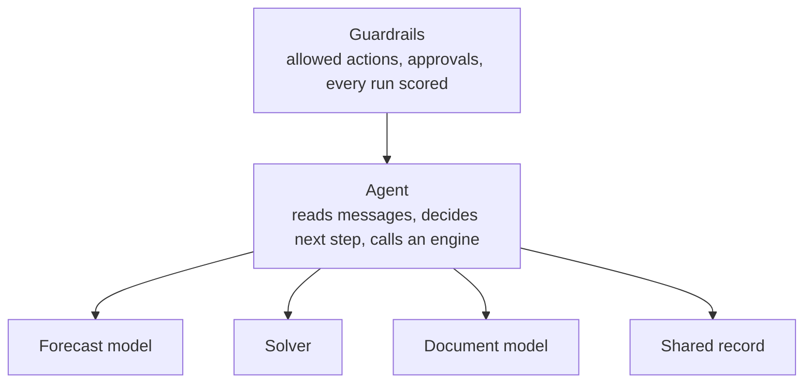

# Technology fit guide

Name the type of problem first. Then pick the tool.

| Problem type | How to recognise it | Reach for | Common mistake |
|---|---|---|---|
| Prediction | The answer is a number you can score later (ETA, demand, dwell time) | Gradient-boosted trees, time-series models, time-series foundation models (Chronos, TimesFM, Moirai) as baselines | Asking an LLM to guess the number |
| Planning | Hard constraints and a cost to minimize (loads, routes, dock slots, production runs) | MILP and routing solvers; an LLM to translate the question and explain the answer | Letting an LLM produce the plan |
| Coordination | Messages, follow-ups and judgment across companies | LLM agents with tools, a fixed list of allowed actions, human approval on money | Another dashboard that leaves the follow-up to people |
| Documents | Information on paper or PDF that should be fields in a system | Document AI or vision-language models plus hard validation rules | An LLM read with nothing checking its output |
| Shared truth | Several parties must agree on what happened, or pool data they won't share | Neutral platforms and standards first; federated learning to share models, not data; a ledger only for a narrow audit job | Starting with the ledger instead of with who has agreed to join |

## The shape that holds up in production

The agent coordinates. Engines compute. Guardrails decide what gets executed.

## Honest verdicts on the hyped technologies

| Technology | Verdict for supply chain today |
|---|---|
| LLM agents | Ready for coordination work, with limits and approvals |
| Time-series foundation models | Strong, cheap baselines; check calibration before trusting the error bars |
| LLM + optimization | Useful as an interface to solvers, not as a solver |
| Federated learning | Ready for pilots between partners; incentives are the hard part |
| Digital twins | Useful as the state agents reason over and as a test bed for agents |
| Blockchain | A narrow job: audit trails where no single operator is trusted |
| Quantum optimization | Watch, don't buy. Classical solvers win today |

## See it run
| Problem type | Demo |
|---|---|
| Prediction | [03 Forecast baselines](../../implementations/03-forecast-baselines) |
| Planning | [04 LLM as solver interface](../../implementations/04-llm-solver-interface), [05 Dock scheduling](../../implementations/05-dock-scheduling) |
| Coordination | [06 Agent with guardrails](../../implementations/06-agent-with-guardrails), [SCX-Bench](../../benchmark) |
| Shared truth | [01 Bullwhip](../../implementations/01-bullwhip-simulator), [07 Federated forecasting](../../implementations/07-federated-forecasting) |
| Sustainability data | [02 Spend vs activity](../../implementations/02-scope3-spend-vs-activity), [08 Scope 3 uncertainty](../../implementations/08-scope3-uncertainty) |
