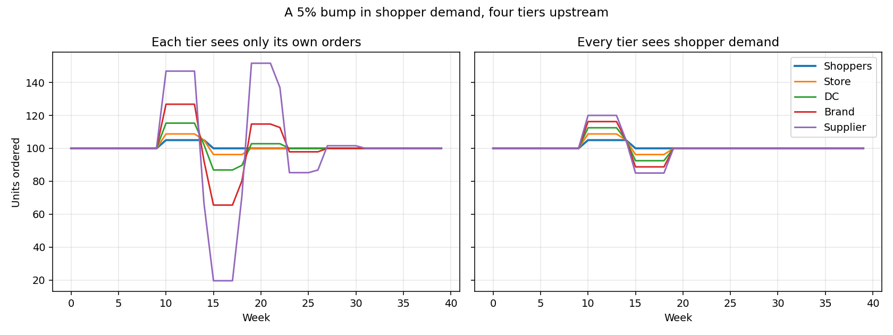

# 01: The bullwhip effect

[](https://colab.research.google.com/github/Deep-Learner-msp/supply-chain-ai-atlas/blob/main/notebooks/01-bullwhip-simulator.ipynb)

A 5% bump in shopper demand travels up a four-tier chain. Every tier uses a sensible, textbook ordering policy (order-up-to with a 4-week moving-average forecast, 2-week lead time). The swing still grows at every step.

```bash
pip install numpy matplotlib
python simulate.py
```

Output (default settings):

| Tier | Peak swing, each tier sees only its own orders | Peak swing, every tier sees shopper demand |
|---|---|---|
| Shoppers | 5.0% | 5.0% |
| Store | 8.8% | 8.8% |
| DC | 15.3% | 12.5% |
| Brand | 34.5% | 16.2% |
| Supplier | 80.4% | 20.0% |



## What to notice

- Nobody made a bad decision. The amplification comes from each tier forecasting the orders of the tier below instead of real demand.
- Sharing point-of-sale demand cuts the supplier's swing from about 80% to 20% here. It does not remove it, because target-stock changes still ripple.
- Try `LEAD_TIME = 4` or `WINDOW = 2` at the top of the script. Longer lead times and twitchier forecasts make it worse.

## Where AI fits

See [docs/lifecycle/01-plan.md](../../docs/lifecycle/01-plan.md). Short version: better forecasting at one tier does not fix this. Sharing the signal does, and federated learning is one way to share it without sharing raw data.
